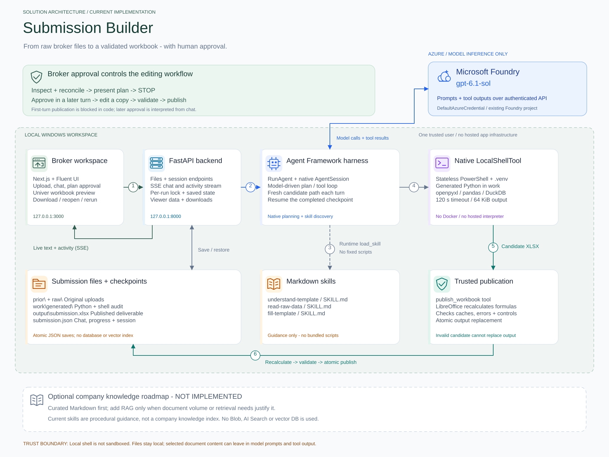
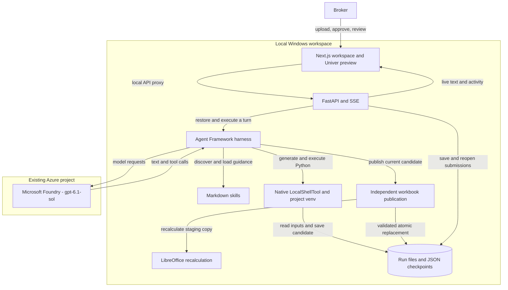
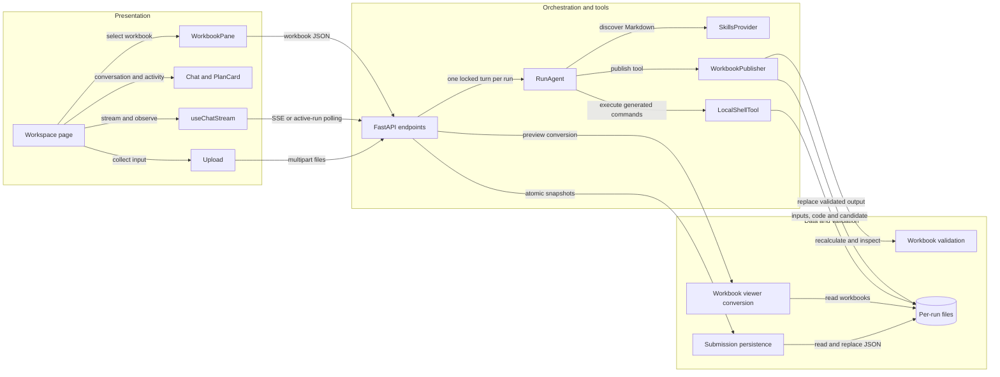

# Architecture Diagram

This describes the **current Submission Builder implementation**, not a proposed Azure deployment.
The application, harness, generated code and workbook validation run on the local Windows
machine. Only model inference uses the configured Microsoft Foundry project.

- [Editable Excalidraw diagram](../../../../../docs/solution-architecture.excalidraw)
- [SVG preview](../../../../../docs/solution-architecture.svg)

Open the Excalidraw file with an Excalidraw-compatible editor, or import it into Excalidraw.
The icons, labels, cards and connectors are native editable vector elements, with related
elements grouped together. No external images, remote icon URLs, credentials or uploaded
customer data are embedded. The SVG opens directly in a browser or VS Code.



## Application Architecture

<!-- mermaid-checked: no \n, no em-dash/en-dash, no {} in labels, subgraphs are id["label"], arrows are -->|"label"|, all subgraphs closed by end, ids unique -->


### Technology Stack Summary

Versions below are pinned versions or declared requirement ranges, not claims about
every globally installed package.

| Layer | Technology | Version | Purpose |
|---|---|---|---|
| Workspace | Next.js / React | Next.js 15.5.28 / React 19.x | Upload, saved submissions, chat and approval |
| Presentation | Fluent UI / Univer | Fluent UI 9.x / Univer 1.1.0 | Controls and read-only spreadsheet preview |
| API | FastAPI / Uvicorn / SSE | FastAPI requirement `>=0.119,<1` | Files, run management, streams and downloads |
| Orchestration | Agent Framework core | 1.22.0 | Native harness, tool loop, skills and sessions |
| Model adapter | Agent Framework Foundry | 1.15.0 | Configured Foundry model client |
| Local execution | Agent Framework tools | 1.0.0b261015 | Native stateless `LocalShellTool` |
| Data computation | Python / openpyxl / pandas / DuckDB | Project Python 3.11; versions constrained in requirements | Document-specific calculations and workbook edits |
| Validation | LibreOffice Calc | Local installation or workspace extraction | Recalculate and inspect formula results |
| Durability | Filesystem / Pydantic JSON | Submission schema version 1 | Inputs, outputs, chat, progress and completed native checkpoints |
| Authentication | Azure Identity | Requirement `>=1.25,<2` | `DefaultAzureCredential`, normally Azure CLI locally |

### Data Storage & External Services

The app uses local `runs\<uuid>` folders, not a database, Blob Storage, vector index,
queue or remote code execution service. The browser uses port 3000 and the API uses
port 8000 by default. Next.js rewrites `/api/...` to the local API.

Foundry receives model prompts, selected document content included in tool output,
and conversation context. The source workbooks are not uploaded to a managed Code
Interpreter container, but **local file storage does not mean document content
never leaves the device**. The SDK uses `store=False`; that is a request option,
not a blanket guarantee about the service's data handling or retention.

### Key Architectural Decisions

- **Guidance rather than hard-coded customer pipelines.** The harness discovers three
  Markdown skills each turn. The model generates Python for the actual uploaded layout;
  there are no bundled executable skill scripts.
- **Review before publication.** The agent proposes a plan and stops for a later broker
  approval message. A code guard blocks first-turn publication. Later approval is
  interpreted conversationally; this is not a production authorization boundary.
- **Local, inspectable work with an independent publication gate.** Generated scripts
  and command audits remain on disk. A separate backend tool recalculates and validates
  a staging copy before atomically replacing the deliverable.

## Component Relationships

<!-- mermaid-checked: no \n, no em-dash/en-dash, no {} in labels, subgraphs are id["label"], arrows are -->|"label"|, all subgraphs closed by end, ids unique -->


### Component Inventory

Paths are relative to the project root.

| Component | Layer | Type | Responsibility |
|---|---|---|---|
| [Workspace page](../../../../../web/app/page.tsx) | Presentation | React page | Selection, upload, rerun and confirmed deletion |
| [Chat stream](../../../../../web/lib/api.ts) | Presentation | React hook and API helpers | SSE messages, full errors and polling reopened active runs |
| [PlanCard](../../../../../web/components/PlanCard.tsx) | Presentation | React component | Activity, elapsed viewing time and expandable error details |
| [WorkbookPane](../../../../../web/components/WorkbookPane.tsx) | Presentation | React component | Read-only original/output preview and download |
| [FastAPI endpoints](../../../../../api/main.py) | API | Eight application endpoints | Upload, list, reopen, delete, rerun, chat, preview and download |
| [RunAgent](../../../../../api/agent.py) | Orchestration | Per-run harness wrapper | Model client, skills, local execution, candidate and session restore |
| [Agent instructions](../../../../../api/AGENTS.md) | Guidance | Markdown | Role, workflow, original preservation and approval rules |
| [Skills](../../../../../api/skills) | Guidance | Three Markdown workflows | Understand template, reconcile raw data and fill approved copy |
| [WorkbookPublisher](../../../../../api/publication.py) | Publication | Trusted backend tool | Fresh candidate, staging, validation and atomic output replacement |
| [Validation](../../../../../api/validation.py) | Validation | Local recalculation and checks | Formula caches, Excel errors and nonzero reconciliation checks |
| [Persistence](../../../../../api/persistence.py) | Data | Pydantic schema and atomic JSON writes | Chat, progress, errors and completed native checkpoint |
| [Viewer conversion](../../../../../api/viewer.py) | Data | Workbook-to-Univer conversion | Formulas, common formatting and changed-cell metadata |
| [Launcher](../../../../../start-all.ps1) | Operations | PowerShell | Start and supervise both local servers |

## How one submission works

1. **Upload.** The broker selects a prior-year `.xlsx` template and current raw
   `.xlsx`, `.csv`, `.txt` or `.md` files. The API validates supported inputs and
   creates a unique run folder. Original inputs are retained separately.
2. **Inspect and reconcile.** The API restores the last completed native session
   and starts one locked turn. The harness loads the relevant Markdown skills and
   generates document-specific Python. `run_shell` executes it locally through
   stateless PowerShell using this project's `.venv`.
3. **Present a plan, then stop.** The agent explains proposed region changes,
   calculations, exclusions and any total-affecting questions. Tool activity and text
   stream to the browser. The broker must approve in a later message.
4. **Edit a working copy.** After approval, generated Python updates a copy and
   saves a candidate at a fresh per-turn path. Intended behavior is to preserve
   source files, styles and formulas. The model does not execute Python inside Foundry.
5. **Validate independently.** The agent calls `publish_workbook`. The backend
   bounds the XLSX archive size, copies the current candidate into staging, uses
   LibreOffice to recalculate, and checks Excel errors, missing formula caches and
   nonzero checks labelled `Check` or `Reconciliation`. Missing LibreOffice blocks
   publication. The validator does **not** prove every business total is correct;
   those also require source reconciliation and broker review.
6. **Publish and review.** Only a valid staging result replaces
   `output\submission.xlsx` through the intended publication path. The browser
   can show changed cells, the broker can request corrections, and Download serves
   the published workbook.
7. **Return later.** Chat and activity are saved before SSE delivery. Completed
   native sessions are checkpointed for continuation. Interrupted turns retain
   partial display history but resume from the last completed checkpoint.

### Saved-run lifecycle

- **Reopen:** restore the selected submission's files and history. Reopening an
  active run polls saved progress every 1.5 seconds without starting another agent turn.
- **Rerun:** copy only the original uploads into a new run, then start inspection.
  The new chat, approval state, generated work and output start empty. The old run remains.
- **Delete:** after confirmation, delete that run's uploads, history, code and output.
  Busy runs cannot be deleted or rerun.
- **Progress:** activity reflects actual tool attempts, not a fabricated completion
  percentage. Elapsed time measures the current busy viewing period.

### Where the files live

```text
runs\<uuid>\
  prior\                   Original template
  raw\                     Uploaded data and broker notes
  work\generated\          Generated Python and executed-command audit
  work\turn-<uuid>\         Fresh candidate path for a turn
  output\submission.xlsx   Published workbook
  submission.json          Chat, progress, errors and completed session checkpoint
```

## Trust boundaries and limitations

`LocalShellTool` runs with the application's OS permissions, inherits its environment,
and is **not sandboxed**. The working directory, `.venv`, timeouts and Markdown rules
are not filesystem or network isolation. Native per-command approval is disabled for
this trusted local workflow. Generated local code is technically capable of bypassing
the intended publication path, so this is not a hardened public or multi-tenant service.

The app has no user sign-in or tenant isolation. Run IDs are local capability identifiers.
Use trusted documents, keep the servers local, and review results. Formula recalculation
is not a guarantee of business correctness or complete fidelity for every Excel feature.

## Relationship to the attached knowledge-store note

The attached `knowledge_store.md` recommends starting with curated Markdown company
knowledge, then adding RAG for larger corpora. That is a **potential extension**, not
an implemented subsystem in this application.

Current skill Markdown describes **how to perform a task**. A company knowledge store
would hold **approved facts, policies and procedures** to retrieve and cite. They should
not be confused. There is currently no company knowledge index, ingestion pipeline,
embedding model, Blob knowledge store, Azure AI Search instance or vector database.

A future implementation could add a separate read-only knowledge tool: first retrieve
approved Markdown notes with provenance, then consider indexed retrieval when the
corpus warrants it. Such a tool would need explicit access controls and source citations,
and would not replace uploaded-data reconciliation or broker approval. The dashed
knowledge-roadmap card in the diagram is deliberately outside the current runtime.
